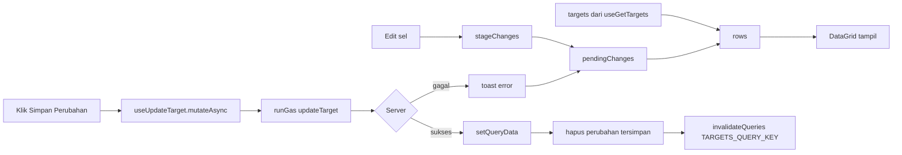
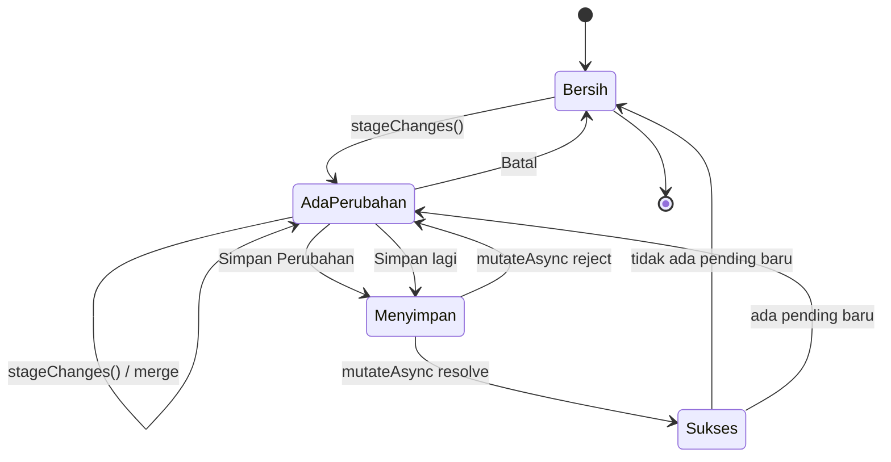

# Dokumentasi Update Target (`updateTarget`)

Dokumen ini menjelaskan kontrak tipe, fungsi, dan alur mutation/state untuk fitur edit target secara batch. Fokus dokumen hanya pada operasi **update**; alur tambah target (`addTarget`) tidak dibahas.

Prinsip utama:

- Perubahan sel ditahan dulu di state lokal `pendingChanges`.
- Tidak ada request ke server saat sel diedit.
- Request baru dikirim ketika user menekan **Simpan Perubahan**.
- Server adalah sumber kebenaran untuk validasi dan kolom turunan (`style`, `parts`, `manPower`).
- Kolom formula `createdAt` (A), `date` (B), dan `rowNumber` (N) tidak ditulis oleh `updateTarget`.

---

## Daftar Isi

- [Ringkasan Alur](#ringkasan-alur)
- [Peta File](#peta-file)
- [Tipe Data](#tipe-data)
- [Fungsi Frontend](#fungsi-frontend)
- [Fungsi Backend](#fungsi-backend)
- [Alur Mutation dan State](#alur-mutation-dan-state)
- [Payload dan Validasi](#payload-dan-validasi)
- [Mock Development](#mock-development)
- [Verifikasi](#verifikasi)
- [Referensi Cepat](#referensi-cepat)

---

## Ringkasan Alur

1. `useGetTargets()` mengambil data target dari server.
2. User mengedit sel. Editor memanggil `stageChanges()` / `changeSpo()`.
3. `stageChanges()` menggabungkan perubahan ke `pendingChanges`.
4. `rows = applyTargetChanges(targets, pendingChanges, styleGroup)` menjadi data yang ditampilkan grid.
5. User menekan **Simpan Perubahan**.
6. `handleSave()` memanggil `useUpdateTarget().mutateAsync({ changes })`.
7. `runGas('updateTarget', data)` menjalankan endpoint server.
8. Server memvalidasi seluruh baris, menghitung ulang kolom turunan, lalu menulis C:M.
9. Jika sukses, cache target diperbarui, perubahan yang tersimpan dihapus dari antrean, dan query di-invalidate.
10. Jika gagal, `pendingChanges` tetap ada supaya user bisa memperbaiki dan mencoba lagi.



---

## Peta File

| File | Peran |
| --- | --- |
| `shared/contracts.d.ts` | Sumber tipe kontrak bersama frontend/backend. |
| `src/types/target.ts` | Re-export tipe target untuk frontend. |
| `src/types/style.ts` | Re-export `Style` dan `StyleGroup`. |
| `src/lib/targetChanges.ts` | Helper murni untuk staging dan preview perubahan. |
| `src/api/updateTarget.ts` | Hook React Query untuk mutation `updateTarget`. |
| `src/api/getTargets.ts` | Query data target. |
| `src/api/queryKeys.ts` | Konstanta query key, termasuk `TARGETS_QUERY_KEY`. |
| `src/components/TargetDataGrid.tsx` | Grid, state `pendingChanges`, handler edit, dan tombol simpan/batal. |
| `server/updateData.ts` | Implementasi endpoint batch `updateTarget` dan helper validasi. |
| `server/getData.ts` | `getStyles()` dan `getTargets()` untuk membaca data pendukung. |
| `server/services.ts` | `withScriptLock()` untuk serialisasi akses spreadsheet. |
| `server/utils.ts` | Parser nilai sel: `toString`, `toNumber`, `splitCellList`. |
| `src/lib/gas.mock.ts` | Mock development untuk `updateTarget`. |
| `src/mocks/target.ts` | Generator data target untuk mock. |

---

## Tipe Data

### `Shift`

```ts
export type Shift = '1' | '2';
```

Nilai shift yang valid. Dipakai oleh `Target.shift` dan divalidasi kembali di server.

### `Target`

```ts
export type Target = {
  createdAt: string;
  date: string;
  line: string;
  shift: Shift;
  spo: string;
  style: string;
  prcs: string[];
  parts: string[];
  manPower: number;
  workingHour: number;
  leader: Leader['nip'];
  operators: Operator['nip'][];
  target: number;
  rowNumber: number;
};
```

Satu baris data target. `rowNumber` adalah identitas baris di grid (`getRowId`) dan juga nomor baris aktual di sheet.

| Field | Tipe | Asal | Bisa diedit? |
| --- | --- | --- | --- |
| `createdAt` | `string` | Kolom A | Tidak |
| `date` | `string` | Kolom B (formula) | Tidak |
| `line` | `string` | Kolom C | Ya |
| `shift` | `Shift` | Kolom D | Ya |
| `spo` | `string` | Kolom E | Ya |
| `style` | `string` | Kolom F (turunan dari SPO) | Tidak |
| `prcs` | `string[]` | Kolom G | Ya |
| `parts` | `string[]` | Kolom H (turunan dari PRC) | Tidak |
| `manPower` | `number` | Kolom I (turunan dari operator) | Tidak |
| `workingHour` | `number` | Kolom J | Ya |
| `leader` | `string` (NIP) | Kolom K | Ya |
| `operators` | `string[]` (NIP) | Kolom L | Ya |
| `target` | `number` | Kolom M | Ya |
| `rowNumber` | `number` | Kolom N (formula `=ROW()`) | Tidak |

### `Style` dan `StyleGroup`

```ts
export type Style = {
  style: string;
  parts: Record<string, string>;
};

export type StyleGroup = Record<string, Style>;
```

`StyleGroup` memetakan SPO ke style dan daftar PRC yang valid. Contoh:

```ts
{
  'SPO-1634': {
    style: 'STY-5413',
    parts: {
      'PRC01': 'Cuff',
      'PRC02': 'Placket',
      'PRC03': 'Sleeve',
    },
  },
}
```

Dipakai untuk:

- Preview `style` dan `parts` di grid.
- Memfilter PRC saat SPO berubah.
- Validasi server: SPO harus ada dan semua PRC harus ada di `style.parts`.

### `TargetEditableField`

```ts
export type TargetEditableField =
  | 'line'
  | 'shift'
  | 'spo'
  | 'prcs'
  | 'workingHour'
  | 'leader'
  | 'operators'
  | 'target';
```

Hanya delapan field ini yang boleh masuk ke payload update. Field lain tidak memiliki tipe untuk diedit dan tidak ditulis oleh server.

### `TargetCellChange`

```ts
export type TargetCellChange = {
  rowNumber: number;
  field: TargetEditableField;
  value: string | number | string[];
};
```

Satu perubahan sel:

- `rowNumber`: nomor baris target, bukan index array.
- `field`: field yang berubah.
- `value`: nilai baru. Gunakan array untuk `prcs` dan `operators`; gunakan string/number untuk field lain.

### `UpdateTargetData`

```ts
export type UpdateTargetData = {
  changes: TargetCellChange[];
};
```

Payload mutation. Satu request boleh berisi banyak perubahan dari banyak baris.

### `GasFunctions['updateTarget']`

```ts
updateTarget: (
  data: UpdateTargetData,
) => { updated: number } | Promise<{ updated: number }>;
```

Kontrak bridge Google Apps Script. `updated` adalah jumlah **baris unik** yang diperbarui, bukan jumlah sel/perubahan.

### `TargetFormData` (terkait, bukan payload update)

```ts
export type TargetFormData = Omit<
  Target,
  'createdAt' | 'date' | 'manPower' | 'rowNumber'
>;
```

Dipakai oleh `addTarget`, bukan `updateTarget`. `style`, `parts`, dan field editable lain tetap ada di tipe ini karena form tambah target membutuhkannya. Untuk update, gunakan `UpdateTargetData`.

### `TargetSheetRow` (server)

```ts
type TargetSheetRow = {
  line: string;
  shift: Shift;
  spo: string;
  style: string;
  prcs: string[];
  parts: string[];
  manPower: number;
  workingHour: number;
  leader: string;
  operators: string[];
  target: number;
};
```

Representasi baris yang dibaca server dari kolom C:M. Tidak memuat `createdAt`, `date`, dan `rowNumber` karena server tidak mengubah kolom A, B, dan N.

### `CellValue` (server)

```ts
type CellValue = string | number | boolean | Date;
```

Tipe nilai mentah sel spreadsheet dari `getValues()`.

### Tipe Eksternal pada Callback Grid

Tipe berikut berasal dari ReUI data-grid dan muncul di signature handler:

```ts
export interface DataGridCellChange<TData> {
  rowId: string;
  columnId: string;
  row: TData;
  previousValue: unknown;
  value: unknown;
}

export interface DataGridCellRejection {
  rowId: string;
  columnId: string;
  raw: string;
  reason: 'readonly' | 'invalid';
}

export type DataGridCellsChangeSource =
  | 'paste'
  | 'cut'
  | 'clear'
  | 'fill'
  | 'edit';

export interface DataGridCellsChangeDetails<TData> {
  source: DataGridCellsChangeSource;
  changes: DataGridCellChange<TData>[];
  rejected: DataGridCellRejection[];
}

export interface DataGridCellEditRequest<TData> {
  rowId: string;
  columnId: string;
  row: TData;
  previousValue: unknown;
  initialText?: string;
}
```

Sumber: `src/components/reui/data-grid/data-grid.tsx`.

---

## Fungsi Frontend

### `runGas`

```ts
export function runGas<K extends keyof GasFunctions>(
  name: K,
  ...args: Parameters<GasFunctions[K]>
): Promise<Awaited<ReturnType<GasFunctions[K]>>>;
```

Menjalankan fungsi backend melalui `google.script.run`. Jika bridge tidak tersedia dan mode development aktif, `runGas` memakai `gasMock`.

Untuk update:

```ts
runGas('updateTarget', { changes })
```

Mengembalikan `Promise<{ updated: number }>`.

### `useUpdateTarget`

```ts
export const useUpdateTarget = () => {
  return useMutation({
    scope: { id: 'target-save' },
    mutationFn: (data: UpdateTargetData) => runGas('updateTarget', data),
    onError: (error) => {
      toast.error('Gagal menyimpan perubahan target', {
        description: error instanceof Error ? error.message : String(error),
      });
    },
  });
};
```

Perilaku:

- Mutation variable: `UpdateTargetData`.
- Mutation data: `{ updated: number }`.
- `scope: { id: 'target-save' }` membuat mutation dengan id yang sama dijalankan berurutan, sehingga klik simpan beruntun tidak saling menimpa.
- `mutationFn` memanggil `runGas('updateTarget', data)`.
- `onError` menampilkan toast error. Pesan error diambil dari `Error.message` atau `String(error)`.
- Tidak ada `onMutate`, `onSuccess`, atau `onSettled` di hook ini.
- Tidak ada optimistic update atau rollback di level hook. Staging dilakukan di komponen; cache baru diperbarui setelah server sukses.
- Komponen memakai `mutateAsync` dan `isPending` (di-alias menjadi `isSaving`).

### `targetChangeKey`

```ts
export const targetChangeKey = (change: TargetCellChange) => string;
```

Menghasilkan kunci unik per sel:

```ts
`${change.rowNumber}:${change.field}`
```

Contoh: `2:spo`, `2:prcs`, `5:operators`.

Dipakai oleh `mergeTargetChanges` agar satu sel hanya punya satu nilai terakhir, dan oleh `TargetDataGrid` untuk membentuk himpunan sel yang diberi penanda `dirty`.

### `toTargetList`

```ts
export const toTargetList = (
  value: TargetCellChange['value'],
): string[];
```

Mengubah nilai menjadi `string[]`:

- Jika array: setiap item di-`String`, di-trim, lalu item kosong dibuang.
- Jika string/number: dipecah dengan koma, di-trim, lalu item kosong dibuang.

Dipakai untuk `prcs` dan `operators`, baik saat preview maupun saat memproses paste.

### `applyTargetChanges`

```ts
export const applyTargetChanges = (
  targets: Target[],
  changes: TargetCellChange[],
  styleGroup: StyleGroup | undefined,
): Target[];
```

Menghasilkan data grid sementara dengan perubahan diterapkan. Fungsi ini tidak mengirim request dan tidak mengubah array input.

Langkah:

1. Jika `changes` kosong, kembalikan `targets` apa adanya.
2. Kelompokkan perubahan berdasarkan `rowNumber` agar tidak scan seluruh changes untuk setiap baris.
3. Untuk setiap baris yang berubah, clone `prcs`, `parts`, dan `operators`.
4. Terapkan semua perubahan baris secara berurutan. Jika ada duplikat field, nilai terakhir menang.
5. Jika ada perubahan `spo` atau `prcs`:
   - Ambil style dari `styleGroup[next.spo]`.
   - Filter `prcs` agar hanya PRC yang ada di `style.parts`.
   - Set `style` dan `parts` dari style tersebut.
   - Jika style tidak ditemukan, nilai turunan lama dibiarkan; validasi final tetap di server.
6. Jika ada perubahan `operators`, hitung ulang `manPower = operators.length`.
7. Kembalikan array baru; baris yang tidak berubah dikembalikan dengan referensi yang sama.

Pemetaan field:

| Field | Efek |
| --- | --- |
| `line` | Trim string. |
| `shift` | Cast ke `Shift`. |
| `spo` | Trim string. |
| `prcs` | `toTargetList`, lalu difilter terhadap style baru. |
| `workingHour` | `Number(value)`. |
| `leader` | Trim string. |
| `operators` | `toTargetList`, lalu `manPower` dihitung ulang. |
| `target` | `Number(value)`. |

### `mergeTargetChanges`

```ts
export const mergeTargetChanges = (
  current: TargetCellChange[],
  next: TargetCellChange[],
): TargetCellChange[];
```

Menggabungkan antrean lama dengan perubahan baru.

- Kunci: `${rowNumber}:${field}`.
- Nilai baru menggantikan nilai lama untuk sel yang sama.
- Urutan kemunculan pertama dipertahankan oleh `Map`.
- Mengembalikan array baru.
- Mencegah payload berisi duplikat untuk sel yang sama.

Contoh:

```ts
mergeTargetChanges(
  [{ rowNumber: 2, field: 'line', value: 'D04' }],
  [
    { rowNumber: 2, field: 'line', value: 'D05' },
    { rowNumber: 2, field: 'shift', value: '2' },
  ],
);
// Hasil: line D05 dan shift 2 untuk baris 2.
```

### `TargetDataGrid`

```ts
export default function TargetDataGrid(): JSX.Element;
```

Komponen utama yang menggabungkan query data, staging lokal, editor sel, dan tombol simpan.

State/ref penting:

| Nama | Tipe | Nilai awal | Fungsi |
| --- | --- | --- | --- |
| `targets` | `Target[]` | `[]` | Data target dari `useGetTargets()`. |
| `styleGroup` | `StyleGroup \| undefined` | dari query | Preview style/parts dan filter PRC. |
| `pendingChanges` | `TargetCellChange[]` | `[]` | Antrean perubahan lokal. |
| `rows` | `Target[]` | hasil memo | `applyTargetChanges(targets, pendingChanges, styleGroup)`. |
| `dirtyRows` | `Set<number>` | hasil memo | Kumpulan `rowNumber` yang punya perubahan lokal. |
| `dirtyCells` | `Set<string>` | hasil memo | Kumpulan kunci `rowNumber:field` untuk penanda sudut sel. |
| `isSaving` | `boolean` | `false` | Alias dari `isPending` mutation. |
| `saveLockRef` | `boolean` | `false` | Mencegah double submit sebelum render berikutnya. |
| `queryClient` | `QueryClient` | dari provider | Untuk `setQueryData` dan `invalidateQueries`. |
| `pagination` | `PaginationState` | halaman 0, size 10 | State pagination grid. |
| `sorting` | `SortingState` | `[]` | State sorting grid. |
| `columnPinning` | `ColumnPinningState` | `date` kiri, `target` kanan | State pin kolom. |

Data grid memakai `rows`, bukan `targets`, sehingga perubahan lokal langsung terlihat tanpa request.

#### Penanda perubahan (`dirty`)

Grid memakai fitur bawaan ReUI, bukan CSS manual:

```ts
const dirtyRows = useMemo(
  () => new Set(pendingChanges.map((change) => change.rowNumber)),
  [pendingChanges],
);
const dirtyCells = useMemo(
  () => new Set(pendingChanges.map(targetChangeKey)),
  [pendingChanges],
);

<DataGrid
  getRowStatus={(row) =>
    dirtyRows.has(row.rowNumber) ? 'dirty' : undefined
  }
  getCellStatus={(row, columnId) =>
    dirtyCells.has(`${row.rowNumber}:${columnId}`)
      ? 'dirty'
      : undefined
  }
/>
```

- `getRowStatus` memberi tint background amber tipis pada seluruh baris yang memiliki perubahan lokal, termasuk kolom yang di-pin.
- `getCellStatus` memberi corner mark amber pada sel yang field-nya ada di `pendingChanges`.
- Kolom turunan seperti `style`, `parts`, dan `manPower` tidak punya `TargetCellChange` sendiri; perubahannya tetap terlihat lewat tint baris.
- Penanda mengikuti `pendingChanges`: hilang saat **Batal** atau setelah perubahan tersimpan, tetap ada saat simpan gagal, dan tetap muncul untuk edit baru yang masuk saat proses simpan.
- Jika nilai sel dikembalikan ke nilai awal, sel masih ditandai sampai disimpan/dibatalkan karena penanda berbasis antrean, bukan perbandingan nilai dengan `targets`.

#### `stageChanges`

```ts
const stageChanges = useCallback((changes: TargetCellChange[]) => {
  if (!changes.length) return;
  setPendingChanges((current) => mergeTargetChanges(current, changes));
}, []);
```

Menambahkan perubahan ke antrean. Tidak melakukan validasi nilai; validasi bentuk nilai dilakukan oleh editor/parse grid, sedangkan validasi bisnis dilakukan server.

#### `stageField`

```ts
const stageField = useCallback(
  (
    rowNumber: number,
    field: TargetEditableField,
    value: string | number | string[],
  ) => {
    stageChanges([{ rowNumber, field, value }]);
  },
  [stageChanges],
);
```

Helper untuk satu sel. Dipanggil oleh editor `line`, `shift`, `prcs`, `leader`, `operators`, dan editor teks bawaan grid.

#### `handleDiscard`

```ts
const handleDiscard = useCallback(() => {
  if (isSaving) return;
  setPendingChanges([]);
}, [isSaving]);
```

Membuang seluruh antrean lokal. Data grid kembali ke `targets` dari server. Tidak ada request ke server. Tombol **Batal** juga dinonaktifkan saat `isSaving` atau saat antrean kosong.

#### `handleSave`

```ts
const handleSave = useCallback(async () => {
  if (!pendingChanges.length || isSaving || saveLockRef.current) return;

  saveLockRef.current = true;
  const changes = pendingChanges;

  try {
    await saveTargets({ changes });

    queryClient.setQueryData<Target[]>(TARGETS_QUERY_KEY, (current) =>
      current ? applyTargetChanges(current, changes, styleGroup) : current,
    );

    const saved = new Set(changes);
    setPendingChanges((current) =>
      current.filter((change) => !saved.has(change)),
    );

    toast.success(`${changes.length} perubahan target disimpan`);
    void queryClient.invalidateQueries({ queryKey: TARGETS_QUERY_KEY });
  } catch {
    // Pesan error sudah ditampilkan oleh useUpdateTarget.
  } finally {
    saveLockRef.current = false;
  }
}, [isSaving, pendingChanges, queryClient, saveTargets, styleGroup]);
```

Urutan detail:

1. Guard: tidak ada perubahan, sedang menyimpan, atau lock aktif → return.
2. Set `saveLockRef.current = true`.
3. Simpan referensi `changes = pendingChanges` pada saat klik.
4. `await saveTargets({ changes })` → mutation masuk status `pending`.
5. Setelah sukses:
   - `setQueryData` menerapkan `changes` ke cache `TARGETS_QUERY_KEY` agar UI langsung sinkron.
   - `saved = new Set(changes)` lalu filter `pendingChanges` berdasarkan **identitas objek**.
   - Hanya objek perubahan yang ikut tersimpan yang dihapus.
   - Perubahan baru yang masuk saat request berjalan tetap berada di antrean.
   - Toast sukses menampilkan jumlah sel yang disimpan.
   - `invalidateQueries` memicu refetch data authoritative dari server.
6. Jika gagal:
   - `catch` tidak melakukan apa-apa karena toast error sudah ditangani hook.
   - `pendingChanges` tidak diubah, perubahan tetap terlihat dan bisa dicoba lagi.
   - Cache target tidak di-rollback karena belum pernah diubah sebelum request.
7. `finally` selalu membuka `saveLockRef`.

Catatan: `setQueryData` di sini terjadi **setelah** server sukses, bukan optimistic update sebelum request. Tujuannya menghindari kedipan data lama sebelum refetch selesai.

`changes.length` adalah jumlah sel/perubahan, sedangkan respons server `{ updated }` menghitung baris unik. Toast memakai jumlah sel.

#### `changeSpo`

```ts
const changeSpo = useCallback(
  (target: Target, spo: string) => {
    const style = styleGroup?.[spo];

    if (!style) {
      toast.error('SPO tidak ditemukan', {
        description: `SPO "${spo}" tidak ada di daftar style.`,
      });
      return;
    }

    const prcs = target.prcs.filter((prc) => style.parts[prc]);
    const dropped = target.prcs.length - prcs.length;

    stageChanges([
      { rowNumber: target.rowNumber, field: 'spo', value: spo },
      { rowNumber: target.rowNumber, field: 'prcs', value: prcs },
    ]);

    if (dropped > 0) {
      toast.info(`${dropped} PRC dikosongkan`, {
        description: `PRC tersebut tidak tersedia untuk SPO ${spo}.`,
      });
    }
  },
  [stageChanges, styleGroup],
);
```

Dipakai oleh `SpoCell`.

- Jika SPO tidak ada di `styleGroup`, perubahan dibatalkan dan toast error muncul.
- PRC lama difilter terhadap style SPO baru.
- Selalu men-stage dua perubahan: `spo` dan `prcs` hasil filter.
- Jika ada PRC yang dibuang, muncul toast informasi.
- `target.prcs` di sini adalah data baris yang sudah termasuk perubahan lokal sebelumnya, karena grid memakai `rows`.

#### `handleCellsChange`

```ts
const handleCellsChange = (
  details: DataGridCellsChangeDetails<Target>,
) => { ... };
```

Menerima batch dari ReUI data-grid untuk operasi:

- paste
- cut
- clear
- fill
- edit teks bawaan (`workingHour`, `target`)

Langkah:

1. Toast error jika ada `details.rejected`.
2. Return jika tidak ada `details.changes`.
3. Jika `styleGroup` belum siap dan batch mengandung perubahan `spo`, batalkan batch.
4. Kumpulkan:
   - `spoRows`: baris yang punya perubahan SPO.
   - `prcsByRow`: nilai PRC eksplisit per baris (jika batch juga membawa PRC).
5. Untuk setiap perubahan:
   - Jika `spo`:
     - Ambil style baru.
     - Sumber PRC = PRC eksplisit di batch, atau `change.row.prcs` jika tidak ada.
     - Filter PRC terhadap style baru.
     - Tambahkan perubahan `spo` dan `prcs` hasil filter.
     - Hitung jumlah PRC yang dibuang.
   - Jika `prcs` dan baris tersebut juga punya perubahan `spo`, lewati karena sudah ditangani bersama SPO baru.
   - Field lain: masukkan apa adanya.
6. `stageChanges(changes)`.
7. Toast informasi jika ada PRC yang dibuang.

Dengan aturan ini, paste satu blok yang mengubah `spo` dan `prcs` sekaligus tetap menghasilkan PRC yang konsisten dengan SPO baru.

#### `handleCellEditRequest`

```ts
const handleCellEditRequest = (
  request: DataGridCellEditRequest<Target>,
) => { ... };
```

Membuka editor kustom saat user menekan Enter/F2 atau mulai mengetik pada sel.

- Jika `initialText !== undefined` (user mulai mengetik), handler langsung return dan tidak mencari/membuka kontrol.
- Untuk Enter/F2 (`initialText` tidak ada), handler mencari kontrol di sel yang sedang fokus: `select-trigger`, `popover-trigger`, `input`, atau `button`.
- Fokus dan klik kontrol tersebut.
- Jika kontrol adalah `HTMLInputElement`, kirim event `ArrowDown` agar combobox membuka daftar.

Handler ini tidak mengubah data; hanya membuka editor.

### Editor Sel

#### `comparePrc`

```ts
function comparePrc(a: string, b: string): number;
```

Membandingkan PRC secara numerik dengan `localeCompare(..., { numeric: true })`, sehingga `PRC02` dan `PRC10` terurut wajar.

#### `LineCell`

```ts
function LineCell({
  value,
  groups,
  onChange,
}: {
  value: string;
  groups: LineGroup[];
  onChange: (next: string) => void;
}): JSX.Element;
```

Select line. `onChange` dari kolom memanggil `stageField(rowNumber, 'line', next)`.

#### `ShiftCell`

```ts
function ShiftCell({
  value,
  onChange,
}: {
  value: string;
  onChange: (next: string) => void;
}): JSX.Element;
```

Select shift `1`/`2`. `onChange` memanggil `stageField(rowNumber, 'shift', next)`.

#### `SpoCell`

```ts
function SpoCell({
  value,
  options,
  onChange,
}: {
  value: string;
  options: string[];
  onChange: (next: string) => void;
}): JSX.Element;
```

Combobox SPO. `onChange` dari kolom memanggil `changeSpo(row.original, next)` agar PRC ikut difilter.

#### `PrcCell`

```ts
function PrcCell({
  spo,
  value,
  styleGroup,
  onChange,
}: {
  spo: string;
  value: string[];
  styleGroup: StyleGroup | undefined;
  onChange: (next: string[]) => void;
}): JSX.Element;
```

Combobox multiple PRC.

- Opsi diambil dari `styleGroup[spo].parts`.
- Nilai yang ditampilkan difilter agar hanya PRC valid.
- Jika user mencoba mengosongkan semua PRC, muncul toast `Pilih minimal satu PRC` dan perubahan tidak diteruskan.
- `onChange` memanggil `stageField(rowNumber, 'prcs', next)`.

#### Editor Leader/Operator

`LeaderCombobox` dan `OperatorCombobox` dipakai langsung di definisi kolom. Keduanya memanggil:

```ts
stageField(row.original.rowNumber, 'leader', next);
stageField(row.original.rowNumber, 'operators', next);
```

### `useGetTargets`

```ts
export const useGetTargets = () => {
  return useQuery({
    queryKey: TARGETS_QUERY_KEY,
    queryFn: () => runGas('getTargets'),
  });
};
```

Mengambil daftar target. Data ini menjadi `targets` di grid dan sumber awal untuk `rows`.

### `useGetStyles`

```ts
export const STYLES_QUERY_KEY = ['styles'] as const;

export const useGetStyles = () => {
  return useQuery({
    queryKey: STYLES_QUERY_KEY,
    queryFn: () => runGas('getStyles'),
    staleTime: 3 * 60 * 60 * 1000,
  });
};
```

Mengambil `StyleGroup` untuk:

- Opsi SPO.
- Opsi PRC.
- Preview `style`/`parts`.
- Filter PRC ketika SPO berubah.

### `TARGETS_QUERY_KEY`

```ts
export const TARGETS_QUERY_KEY = ['targets'] as const;
```

Query key untuk cache target. Dipakai oleh:

- `useGetTargets`
- `setQueryData` setelah simpan sukses
- `invalidateQueries` setelah simpan sukses

---

## Fungsi Backend

### `updateTarget`

```ts
function updateTarget({
  changes,
}: UpdateTargetData): { updated: number };
```

Endpoint batch utama.

Alur:

1. Jika `changes` kosong, langsung return `{ updated: 0 }`.
2. Jalankan seluruh proses di dalam `withScriptLock`.
3. Buka spreadsheet dan sheet target dari `SPREADSHEET_CONFIG`.
4. Ambil `lastRow`, `getStyles()`, dan kelompokkan changes per `rowNumber`.
5. Untuk setiap baris:
   - Validasi `rowNumber` integer dan berada di rentang `2..lastRow`.
   - Baca C:M.
   - `readTargetSheetRow`.
   - Terapkan setiap perubahan lewat `applyTargetCellChange_`.
   - Validasi hasil akhir baris.
   - Cari style berdasarkan SPO.
   - Pastikan semua PRC valid.
   - Hitung ulang `style`, `parts`, dan `manPower`.
   - Simpan nilai final ke daftar `writes`.
6. Setelah **semua** baris valid dan dihitung, baru tulis C:M per baris.
7. Return `{ updated: byRow.size }`.

Karena validasi dan perhitungan dilakukan sebelum penulisan, satu request batch tidak meninggalkan baris setengah jadi jika ada nilai invalid.

### `applyTargetCellChange_`

```ts
function applyTargetCellChange_(
  row: TargetSheetRow,
  change: TargetCellChange,
): void;
```

Menerapkan satu perubahan ke `TargetSheetRow` di memori dan melakukan validasi field.

| Field | Perilaku |
| --- | --- |
| `line` | Trim; wajib tidak kosong. |
| `shift` | Harus `'1'` atau `'2'`. |
| `spo` | Trim; wajib tidak kosong. |
| `prcs` | `targetCellList_`; validasi minimal satu PRC dilakukan setelah semua perubahan baris. |
| `workingHour` | `targetCellInteger_`; harus integer 1..11. |
| `leader` | Trim; wajib tidak kosong. |
| `operators` | `targetCellList_`; boleh kosong. |
| `target` | `targetCellInteger_`; harus integer minimal 1. |
| lainnya | Throw `Field target tidak dikenal`. |

### `targetCellList_`

```ts
function targetCellList_(
  value: TargetCellChange['value'],
): string[];
```

Mengubah nilai array atau string berkoma menjadi `string[]` yang sudah di-trim dan bebas item kosong. Dipakai untuk `prcs` dan `operators` di server.

### `targetCellInteger_`

```ts
function targetCellInteger_(
  value: TargetCellChange['value'],
  label: string,
): number;
```

Parser angka untuk `workingHour` dan `target`.

- Array ditolak.
- Number langsung dipakai.
- String dihapus koma, di-trim, lalu di-`Number`.
- String kosong → error `${label} wajib diisi`.
- Bukan integer → error `${label} tidak valid: ${raw}`.

### `readTargetSheetRow`

```ts
function readTargetSheetRow(row: CellValue[]): TargetSheetRow;
```

Memetakan nilai C:M menjadi `TargetSheetRow`.

| Index `row` | Kolom sheet | Field |
| --- | --- | --- |
| `0` | C | `line` |
| `1` | D | `shift` |
| `2` | E | `spo` |
| `3` | F | `style` |
| `4` | G | `prcs` |
| `5` | H | `parts` |
| `6` | I | `manPower` |
| `7` | J | `workingHour` |
| `8` | K | `leader` |
| `9` | L | `operators` |
| `10` | M | `target` |

### `withScriptLock`

```ts
function withScriptLock<T>(callback: () => T): T;
```

Menjalankan callback secara eksklusif memakai `LockService.getScriptLock()`.

- Timeout lock: `60_000` ms.
- Jika lock gagal didapat, throw error bahwa server sedang memproses data lain.
- Log jika waktu tunggu ≥ 2 detik.
- Log error jika callback gagal.
- `SpreadsheetApp.flush()` dipanggil di `finally` sebelum lock dilepas.
- Lock selalu dilepas di `finally`.

### `getStylesFromSheet`

```ts
function getStylesFromSheet(): StyleGroup;
```

Membangun `StyleGroup` dari sheet `spoAndPrc`:

- Mulai baris 3, kolom C, empat kolom.
- `spo`: kolom C.
- `style`: kolom D.
- `prc`: kolom E, di-uppercase.
- `part`: kolom F.
- Hanya PRC dengan format `/^PRC\d{2}$/` yang diterima.
- PRC pertama untuk SPO tertentu yang dipakai; duplikat diabaikan.

### `getStyles`

```ts
function getStyles(): ReturnType<GasFunctions['getStyles']>;
```

Wrapper cache untuk `getStylesFromSheet` dengan TTL 6 jam. Dipakai `updateTarget` untuk validasi SPO/PRC dan perhitungan ulang style/parts.

### `getTargets`

```ts
function getTargets(): ReturnType<GasFunctions['getTargets']>;
```

Membaca seluruh target dari sheet.

- Membaca semua baris lewat `getDataRange()`.
- Melewati baris yang `line`, `spo`, dan `target` semuanya kosong; ini mencegah baris formula B/N di bawah data ikut tampil.
- Memetakan kolom A:N ke `Target`.
- `rowNumber` diambil dari kolom N (`row[13]`), bukan index array.
- `date` dari kolom B, `createdAt` dari kolom A.
- `prcs`, `parts`, dan `operators` dipecah dengan `splitCellList`.

### Utility Server

```ts
function toString(value: CellValue): string;
function toNumber(value: CellValue): number;
function splitCellList(value: CellValue): string[];
```

- `toString`: `String(value).trim()`.
- `toNumber`: pastikan nilai number/string dan finite; throw jika tidak valid.
- `splitCellList`: `toString`, split koma, trim, filter kosong.

`getTargets` juga memakai dua formatter tanggal:

```ts
function toDateTimeString(value: CellValue): string;
function toDateString(value: CellValue): string;
```

- Jika nilai berupa `Date`: format memakai timezone script (`dd/MM/yyyy HH:mm:ss` atau `dd/MM/yyyy`); tanggal invalid akan throw.
- Jika nilai kosong/falsy: hasilnya string kosong.
- Nilai lain: diubah ke string dan di-trim.

### Konstanta Backend

```ts
const TARGET_FIRST_COLUMN = 3;   // Kolom C
const TARGET_COLUMN_COUNT = 11;  // C sampai M
const SCRIPT_LOCK_TIMEOUT_MS = 60_000;
const SCRIPT_LOCK_WAIT_LOG_MS = 2_000;
```

---

## Alur Mutation dan State

### Diagram State



### Tabel State

| Tahap | `pendingChanges` | `isSaving` | Badge | Tombol Simpan/Batal | Sumber data grid | Penanda dirty |
| --- | --- | --- | --- | --- | --- | --- |
| Bersih | `[]` | `false` | Tidak ada | Disabled | `targets` | Tidak ada |
| Ada perubahan | `n > 0` | `false` | `n perubahan` | Enabled | `rows = applyTargetChanges(...)` | Tint baris + corner mark sel |
| Menyimpan | `n > 0` (captured) | `true` | `Menyimpan…` | Disabled | `rows` | Tint baris + corner mark sel |
| Sukses tanpa edit baru | `[]` | `false` | Tidak ada | Disabled | Cache hasil `setQueryData` lalu refetch | Tidak ada |
| Sukses dengan edit baru | `m > 0` | `false` | `m perubahan` | Enabled | `rows` dengan pending baru | Tint baris + corner mark untuk pending baru |
| Gagal | `n > 0` | `false` | `n perubahan` | Enabled | `rows` dengan pending tetap | Tint baris + corner mark sel |
| Batal | `[]` | `false` | Tidak ada | Disabled | `targets` | Tidak ada |

`isSaving` adalah alias dari `isPending` milik mutation React Query.

### Skenario 1 — Edit Satu Sel

1. User mengubah line/shift/PRC/leader/operator.
2. Editor memanggil `stageField`.
3. `stageField` memanggil `stageChanges` dengan satu `TargetCellChange`.
4. `mergeTargetChanges` mengganti nilai sel tersebut jika sudah ada di antrean.
5. `pendingChanges` berubah; `rows` dihitung ulang.
6. Tidak ada request ke server.
7. Badge jumlah perubahan muncul; tombol simpan/batal aktif.
8. Baris diberi tint `dirty` dan sel yang berubah diberi corner mark.

### Skenario 2 — Paste/Fill Banyak Sel

1. ReUI data-grid memanggil `onCellsChange` satu kali untuk seluruh batch.
2. `handleCellsChange` memproses `details.changes`.
3. Perubahan yang ditolak (`details.rejected`) hanya memunculkan toast.
4. Perubahan valid diubah menjadi `TargetCellChange[]`.
5. `stageChanges` menggabungkan seluruh batch sekaligus.
6. Grid menampilkan hasilnya lewat `applyTargetChanges`.

### Skenario 3 — Ganti SPO

1. `SpoCell` memanggil `changeSpo`.
2. `changeSpo` mencari style SPO baru di `styleGroup`.
3. PRC lama difilter berdasarkan `style.parts`.
4. `stageChanges` menerima dua perubahan: `spo` dan `prcs`.
5. `applyTargetChanges` memperbarui preview `style`, `parts`, dan PRC.
6. Jika ada PRC yang dibuang, toast informasi muncul.
7. Server akan mengulang validasi dan perhitungan yang sama saat disimpan.

### Skenario 4 — Simpan Sukses

1. User klik **Simpan Perubahan**.
2. `handleSave` mengunci `saveLockRef`.
3. `mutateAsync({ changes })` dipanggil.
4. Mutation masuk `pending`; tombol disabled dan badge berubah menjadi `Menyimpan…`.
5. Server memvalidasi dan menulis.
6. Promise resolve.
7. `setQueryData` menerapkan perubahan ke cache target.
8. Perubahan yang tersimpan dihapus dari `pendingChanges` berdasarkan identitas objek.
9. Toast sukses muncul.
10. `invalidateQueries` memicu refetch data terbaru.
11. Mutation selesai; `isSaving` kembali `false`.

### Skenario 5 — Simpan Gagal

1. Mutation masuk `pending`.
2. Server mengembalikan error (misalnya PRC kosong, jam tidak valid, atau SPO tidak ditemukan).
3. `onError` di `useUpdateTarget` menampilkan toast error.
4. `handleSave` menangkap error tanpa mengubah `pendingChanges`.
5. Cache target tidak di-rollback karena belum diubah sebelum request.
6. Data grid tetap menampilkan perubahan lokal.
7. User dapat memperbaiki nilai lalu klik simpan lagi.

### Skenario 6 — Edit Saat Proses Simpan

1. `handleSave` menyimpan referensi `changes` saat tombol diklik.
2. Selama request berjalan, user masih bisa mengedit sel lain.
3. Edit baru masuk ke `pendingChanges` dan tidak termasuk dalam `changes` yang sedang dikirim.
4. Setelah request sukses, `saved = new Set(changes)` hanya menghapus objek perubahan yang ikut tersimpan.
5. Edit baru tetap berada di antrean dan badge tetap menunjukkan jumlahnya.
6. Cache menerima perubahan yang sudah tersimpan; edit baru tetap terlihat lewat overlay `rows`.

Inilah alasan filter memakai identitas objek, bukan hanya kunci `rowNumber:field`: jika sel yang sama diedit ulang saat request berjalan, objek barunya tidak boleh ikut terhapus.

### Skenario 7 — Batal

1. Tombol **Batal** aktif hanya jika ada pending dan tidak sedang menyimpan.
2. `handleDiscard` mengosongkan `pendingChanges`.
3. `rows` kembali ke `targets`.
4. Tidak ada request ke server.
5. Badge hilang, tint baris/corner mark hilang, dan tombol simpan/batal disabled.

### Skenario 8 — Refresh

1. Tombol **Refresh** memanggil `refetch()` dari `useGetTargets`.
2. Tombol disabled saat `isFetching` atau `isSaving`.
3. `pendingChanges` tidak dihapus.
4. Setelah data server datang, `rows` tetap menerapkan pending di atas data baru.
5. Jika tidak ada pending, grid langsung menampilkan data server terbaru.

### Tentang Rollback

Tidak ada rollback cache karena tidak ada optimistic mutation sebelum request:

- Staging hanya mengubah state lokal.
- Cache `TARGETS_QUERY_KEY` baru diubah setelah server sukses.
- Jika server gagal, cache tetap berisi data terakhir yang diketahui.
- `pendingChanges` tetap ada, sehingga user tidak kehilangan hasil edit.

### Catatan Persistensi

- `pendingChanges` tidak disimpan ke localStorage.
- Menutup dialog/halaman sebelum menyimpan dapat menghilangkan antrean lokal.
- Gunakan **Simpan Perubahan** atau **Batal** secara eksplisit.

---

## Payload dan Validasi

### Contoh Payload

```json
{
  "changes": [
    {
      "rowNumber": 2,
      "field": "spo",
      "value": "SPO-1634"
    },
    {
      "rowNumber": 2,
      "field": "prcs",
      "value": ["PRC05", "PRC06"]
    },
    {
      "rowNumber": 5,
      "field": "operators",
      "value": ["MGM 7490", "MGM 15705"]
    },
    {
      "rowNumber": 5,
      "field": "workingHour",
      "value": 6
    }
  ]
}
```

### Contoh Response

```json
{
  "updated": 2
}
```

`updated` menghitung baris unik: baris 2 dan baris 5, walaupun ada empat perubahan sel.

### Tipe Nilai per Field

| Field | Tipe nilai yang dikirim client | Contoh |
| --- | --- | --- |
| `line` | `string` | `"D04"` |
| `shift` | `string` (`"1"`/`"2"`) | `"2"` |
| `spo` | `string` | `"SPO-1634"` |
| `prcs` | `string[]` | `["PRC05", "PRC06"]` |
| `workingHour` | `number` | `6` |
| `leader` | `string` (NIP) | `"MGM 12071"` |
| `operators` | `string[]` (NIP) | `["MGM 7490"]` |
| `target` | `number` | `680` |

Server juga menerima string berkoma untuk `prcs` dan `operators` melalui `targetCellList_`, tetapi client mengirim array.

### Validasi Server

| Aturan | Error |
| --- | --- |
| `rowNumber` harus integer dan berada di `2..lastRow` | `Row number tidak valid: ...` |
| `line` tidak boleh kosong | `Line tidak boleh kosong` / `Line baris N kosong` |
| `shift` harus `'1'` atau `'2'` | `Shift tidak valid: ...` |
| `spo` tidak boleh kosong | `SPO tidak boleh kosong` |
| `spo` harus ada di `StyleGroup` | `SPO '...' tidak ditemukan` |
| `prcs` minimal satu | `Baris N harus punya minimal satu PRC` |
| Semua PRC harus ada di style SPO | `PRC ... tidak tersedia untuk SPO ...` |
| `leader` tidak boleh kosong | `Leader tidak boleh kosong` |
| `workingHour` integer 1..11 | `Jam kerja harus antara 1 dan 11` |
| `target` integer minimal 1 | `Target minimal 1` |
| `operators` boleh kosong | Tidak ada error; `manPower` menjadi 0 |

Validasi dilakukan untuk seluruh baris sebelum penulisan dimulai.

### Kolom yang Ditulis

`updateTarget` hanya membaca dan menulis **C:M**:

| Kolom | Field | Ditulis `updateTarget`? |
| --- | --- | --- |
| A | `createdAt` | Tidak |
| B | `date` (formula) | Tidak |
| C | `line` | Ya |
| D | `shift` | Ya |
| E | `spo` | Ya |
| F | `style` | Ya (hasil hitung ulang) |
| G | `prcs` | Ya |
| H | `parts` | Ya (hasil hitung ulang) |
| I | `manPower` | Ya (hasil hitung ulang) |
| J | `workingHour` | Ya |
| K | `leader` | Ya |
| L | `operators` | Ya |
| M | `target` | Ya |
| N | `rowNumber` (formula `=ROW()`) | Tidak |

Kolom turunan selalu dihitung ulang dari data final baris, bukan hanya ketika field sumbernya berubah. Ini membuat F/H/I tetap konsisten meskipun data lama diedit dari kolom lain.

---

## Mock Development

Mock dipakai ketika `google.script.run` tidak tersedia dan `import.meta.env.DEV` aktif.

### `gasMock.updateTarget`

```ts
updateTarget: (data: UpdateTargetData) => {
  return new Promise((resolve) => {
    setTimeout(() => {
      resolve({ updated: applyMockChanges(data.changes) });
    }, 400);
  });
};
```

- Menunggu 400 ms untuk mensimulasikan request.
- Mengembalikan `{ updated }`.
- Tidak melakukan validasi seperti server asli.

### `applyMockChanges`

```ts
const applyMockChanges = (changes: TargetCellChange[]) => number;
```

- Mencari `mockTargets` berdasarkan `rowNumber`.
- Menerapkan field yang berubah.
- Menghitung ulang `style`, `parts`, dan `manPower` saat `spo`/`prcs`/`operators` berubah.
- Melewati baris yang tidak ditemukan.
- Mengembalikan jumlah baris unik yang berubah.

### `toMockList`

```ts
const toMockList = (
  value: TargetCellChange['value'],
): string[];
```

Parser array/string berkoma untuk mock, sama seperti `toTargetList` di frontend.

### Catatan Mock

- Mock tidak mereproduksi atomic validation, row bounds, atau aturan minimal satu PRC.
- Mock memakai data style acak yang dibuat saat module dimuat.
- Untuk perilaku validasi sebenarnya, gunakan server Apps Script atau test backend.
- `getTargets` mock mengembalikan clone agar mutasi `mockTargets` tidak mengubah referensi yang sudah dikirim ke UI.

---

## Verifikasi

Perintah yang relevan:

```bash
pnpm typecheck
pnpm build
pnpm test
pnpm exec eslint src/components/TargetDataGrid.tsx src/lib/targetChanges.ts src/api/updateTarget.ts
```

Skenario runtime yang sudah diverifikasi:

- Edit shift dan jam → badge `2 perubahan`, tidak ada request sebelum simpan.
- Klik **Batal** → nilai kembali, refresh tidak mengubah data server.
- Klik **Simpan Perubahan** → data tersimpan, badge hilang, toast sukses.
- Ganti SPO → preview Style/Part/PRC berubah lokal, lalu tersimpan setelah simpan.
- Simpan saat ada nilai invalid → error toast, antrean tetap ada untuk diperbaiki.
- Edit saat proses simpan → perubahan baru tetap di antrean.

---

## Referensi Cepat

| Simbol | Jenis | File |
| --- | --- | --- |
| `Shift` | type | `shared/contracts.d.ts` |
| `Target` | type | `shared/contracts.d.ts` |
| `TargetFormData` | type terkait `addTarget` | `shared/contracts.d.ts` |
| `Style`, `StyleGroup` | type | `shared/contracts.d.ts` |
| `TargetEditableField` | type | `shared/contracts.d.ts` |
| `TargetCellChange` | type | `shared/contracts.d.ts` |
| `UpdateTargetData` | type | `shared/contracts.d.ts` |
| `GasFunctions.updateTarget` | function type | `shared/contracts.d.ts` |
| `TargetSheetRow` | type | `server/updateData.ts` |
| `CellValue` | type | `server/types/spreadsheet.d.ts` |
| `DataGridCellChange` | type eksternal | `src/components/reui/data-grid/data-grid.tsx` |
| `DataGridCellRejection` | type eksternal | `src/components/reui/data-grid/data-grid.tsx` |
| `DataGridCellsChangeSource` | type eksternal | `src/components/reui/data-grid/data-grid.tsx` |
| `DataGridCellsChangeDetails` | type eksternal | `src/components/reui/data-grid/data-grid.tsx` |
| `DataGridCellEditRequest` | type eksternal | `src/components/reui/data-grid/data-grid.tsx` |
| `TARGETS_QUERY_KEY` | constant | `src/api/queryKeys.ts` |
| `STYLES_QUERY_KEY` | constant | `src/api/queryKeys.ts` |
| `runGas` | function | `src/lib/gas.ts` |
| `useGetTargets` | hook | `src/api/getTargets.ts` |
| `useGetStyles` | hook | `src/api/getStyles.ts` |
| `useUpdateTarget` | hook | `src/api/updateTarget.ts` |
| `targetChangeKey` | function | `src/lib/targetChanges.ts` |
| `toTargetList` | function | `src/lib/targetChanges.ts` |
| `applyTargetChanges` | function | `src/lib/targetChanges.ts` |
| `mergeTargetChanges` | function | `src/lib/targetChanges.ts` |
| `TargetDataGrid` | component | `src/components/TargetDataGrid.tsx` |
| `dirtyRows` | local state | `src/components/TargetDataGrid.tsx` |
| `dirtyCells` | local state | `src/components/TargetDataGrid.tsx` |
| `getRowStatus` | ReUI prop | `src/components/reui/data-grid/data-grid.tsx` |
| `getCellStatus` | ReUI prop | `src/components/reui/data-grid/data-grid.tsx` |
| `stageChanges` | local function | `src/components/TargetDataGrid.tsx` |
| `stageField` | local function | `src/components/TargetDataGrid.tsx` |
| `handleDiscard` | local function | `src/components/TargetDataGrid.tsx` |
| `handleSave` | local function | `src/components/TargetDataGrid.tsx` |
| `changeSpo` | local function | `src/components/TargetDataGrid.tsx` |
| `handleCellsChange` | local function | `src/components/TargetDataGrid.tsx` |
| `handleCellEditRequest` | local function | `src/components/TargetDataGrid.tsx` |
| `comparePrc` | local function | `src/components/TargetDataGrid.tsx` |
| `LineCell` | local component | `src/components/TargetDataGrid.tsx` |
| `ShiftCell` | local component | `src/components/TargetDataGrid.tsx` |
| `SpoCell` | local component | `src/components/TargetDataGrid.tsx` |
| `PrcCell` | local component | `src/components/TargetDataGrid.tsx` |
| `updateTarget` | server function | `server/updateData.ts` |
| `applyTargetCellChange_` | server helper | `server/updateData.ts` |
| `targetCellList_` | server helper | `server/updateData.ts` |
| `targetCellInteger_` | server helper | `server/updateData.ts` |
| `readTargetSheetRow` | server helper | `server/updateData.ts` |
| `withScriptLock` | server helper | `server/services.ts` |
| `getStylesFromSheet` | server function | `server/getData.ts` |
| `getStyles` | server function | `server/getData.ts` |
| `getTargets` | server function | `server/getData.ts` |
| `toString` | utility | `server/utils.ts` |
| `toNumber` | utility | `server/utils.ts` |
| `splitCellList` | utility | `server/utils.ts` |
| `toDateTimeString` | utility | `server/utils.ts` |
| `toDateString` | utility | `server/utils.ts` |
| `gasMock.updateTarget` | mock | `src/lib/gas.mock.ts` |
| `applyMockChanges` | mock helper | `src/lib/gas.mock.ts` |
| `toMockList` | mock helper | `src/lib/gas.mock.ts` |
